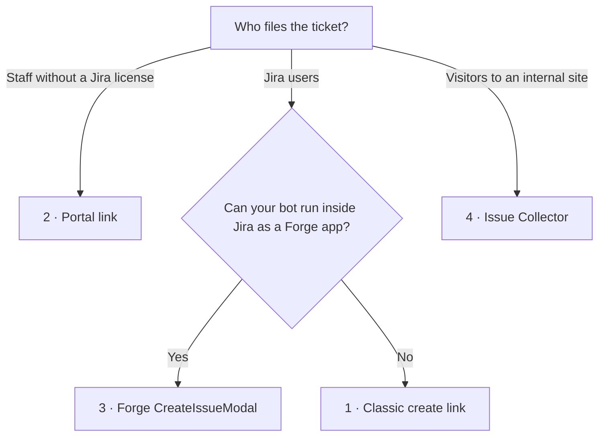

# Appendix · Other ways to open Jira with fields prefilled

[עברית](appendix-create-entry-points.he.md) · [1 Access](01-read-only-access.en.md) · [2 Reading Jira](02-reading-jira.en.md) · [3 The create link](03-create-link.en.md) · [4 Chatbot integration](04-chatbot-integration.en.md) · **Appendix**

Guide 3 uses the classic create link. Jira has other entry points that open a create form with values filled in. Each suits a different audience, and none creates anything until the person submits.

## Which one to use

| Entry point | Best for | The person needs | Prefills | Stability |
| --- | --- | --- | --- | --- |
| [1. Classic create link](#1-classic-create-link) | Jira users filing into software or business projects | A Jira license | Any field on the create screen | Documented on Data Center. On Cloud it works but is legacy. |
| [2. Service desk portal link](#2-service-desk-portal-link) | Staff filing IT, HR, or facilities requests | Only portal access (no license) | Summary, description, request-type fields | Supported, with rough edges |
| [3. Forge `CreateIssueModal`](#3-forge-createissuemodal) | A chatbot or page running **inside** Jira as a Forge app | A Jira license | Most system fields and custom fields | Officially supported, modern create dialog |
| [4. Issue Collector](#4-issue-collector) | A feedback button on an internal website | Nothing, or a Jira account, depending on setup | Text, select, and custom fields | Older technology |
| [5. Jira Forms](#5-jira-forms) | Business teams | A Jira license | No native URL prefill | Needs a Marketplace app |



---

## 1. Classic create link

Covered in full in [guide 3](03-create-link.en.md):

```
https://your-company.atlassian.net/secure/CreateIssueDetails!init.jspa?pid=10001&issuetype=10011&summary=Booking%20page%20crashes&priority=2
```

**The Cloud risk.** In 2022 Atlassian announced it would retire the full-page create screen on Cloud and redirect `CreateIssue.jspa` URLs to the newer create experience. As of a May 2026 bug report, `CreateIssueDetails!init.jspa` still opens the old screen with its parameters. Atlassian hasn't said whether prefill will survive a redirect. On Data Center this link is documented and stable.

**Check it now and then:** open a full link from your chatbot while signed in. If you land on a different-looking create dialog with empty fields, prefill has stopped working, and it's time to move to option 2 or 3.

---

## 2. Service desk portal link

Jira Service Management portals take field values from the URL. This is the usual enterprise choice: anyone with portal access can file, without a Jira license, and the request arrives with the right request type.

```
https://your-company.atlassian.net/servicedesk/customer/portal/{portalId}/create/{requestTypeId}?summary=…&description=…&customfield_NNNNN=…
```

### Example

A laptop request to IT. The portal ID is 3, the request type is 27 ("Hardware problem"), and its "Urgency" field is `customfield_10050`:

```
https://your-company.atlassian.net/servicedesk/customer/portal/3/create/27
  ?summary=Laptop%20won%27t%20boot%20after%20update
  &description=Since%20this%20morning%27s%20update%20the%20laptop%20shows%20a%20black%20screen.
  &customfield_10050=10021
```

`10021` is the **option ID** for "High". Dropdowns, checkboxes, and radio buttons take option IDs, not labels.

### Finding the IDs (read-only REST)

The same read-only approach as [guide 2](02-reading-jira.en.md). The token also needs JSM read access. On Cloud, add the scope `read:servicedesk-request`.

```bash
# Service desks (projects with a portal)
curl -u "$EMAIL:$TOKEN" "$JIRA/rest/servicedeskapi/servicedesk"
# {"values":[{"id":"3","projectKey":"IT","projectName":"IT Support"}]}

# Request types; each carries the portalId used in the URL
curl -u "$EMAIL:$TOKEN" "$JIRA/rest/servicedeskapi/servicedesk/3/requesttype"
# {"values":[{"id":"27","name":"Hardware problem","portalId":"3","issueTypeId":"10004"}]}

# Fields on that request form, with option IDs
curl -u "$EMAIL:$TOKEN" "$JIRA/rest/servicedeskapi/servicedesk/3/requesttype/27/field"
# {"requestTypeFields":[
#   {"fieldId":"summary","name":"What's wrong?","required":true,"validValues":[]},
#   {"fieldId":"customfield_10050","name":"Urgency","required":false,
#    "validValues":[{"value":"10020","label":"Low"},{"value":"10021","label":"High"}]}]}
```

Only fields returned by the `field` call are on the portal form. Anything else in the URL is ignored. Data Center uses the same paths.

### A builder

```ts
export function buildPortalLink(
  site: string, portalId: string, requestTypeId: string,
  fields: Record<string, string | undefined>,          // fieldId → value (option ID for selects)
) {
  const params = new URLSearchParams();
  for (const [fieldId, value] of Object.entries(fields)) if (value) params.set(fieldId, value);
  const query = params.toString().replace(/\+/g, "%20");
  return `${site}/servicedesk/customer/portal/${portalId}/create/${requestTypeId}${query ? `?${query}` : ""}`;
}

buildPortalLink("https://your-company.atlassian.net", "3", "27", {
  summary: "Laptop won't boot after update",
  customfield_10050: "10021",
});
// https://your-company.atlassian.net/servicedesk/customer/portal/3/create/27?summary=Laptop%20won%27t%20boot%20after%20update&customfield_10050=10021
```

### Rough edges

- If the person switches request type or navigates away inside the portal, the URL values are lost.
- Fields that come from an attached **Form** (as opposed to request-type fields) often don't prefill.
- Some prefilled dropdowns still fail validation, and the person has to pick the value again.
- People have reported prefill breaking after portal updates. Test the link again from time to time.

---

## 3. Forge `CreateIssueModal`

If your bot or page can run **inside Jira** as a Forge app (for example a global page, a panel on a work item, or a chat UI you host in Jira), Atlassian's `CreateIssueModal` opens the **modern** create dialog with values prefilled. This is the officially supported route, and it doesn't depend on legacy URLs.

```ts
import { CreateIssueModal } from "@forge/jira-bridge";

const adf = (text: string) => ({
  type: "doc", version: 1,
  content: text.split("\n").map(line => ({ type: "paragraph", content: line ? [{ type: "text", text: line }] : [] })),
});

new CreateIssueModal({
  context: {
    projectId: "10001",
    issueTypeId: "10011",                       // Bug
    summary: "Booking page crashes on Safari when selecting a date",
    description: adf("Steps to reproduce:\n1. Open the booking page in Safari\n2. Pick a date"),
    reporter: "712020…",                        // account ID
    priority: "2",                              // priority ID
    labels: ["safari"],
    fixVersions: ["10000"],
    customfield_10050: "EU",                    // custom fields by ID
  },
  onClose: ({ payload }) => {
    // The IDs of tickets the person actually created. The bot can now confirm "Created DESK-42".
    const created = payload.map(item => item.issueId);
  },
}).open();
```

What sets it apart:

- **It knows the result.** `onClose` returns the created ticket IDs. With a link, the bot never learns whether the person pressed Create.
- **The description is a document object** in Atlassian Document Format, not plain text, which is why the example uses `adf()`.
- **Weak spots:** developers report that `parentId` (epic) and `components` sometimes don't fill, and subtasks aren't supported. Check these on your site.
- **It also supports `requestType`** for Jira Service Management projects.
- The cost is a Forge app installed in your Jira site, not just a chatbot outside it.

---

## 4. Issue Collector

A small script, embedded on an internal web page, that shows a "Feedback" button and a short create form. Defaults are set in `fieldValues`, using the field names from the Jira create screen:

```js
window.ATL_JQ_PAGE_PROPS = $.extend(window.ATL_JQ_PAGE_PROPS, {
  fieldValues: {
    summary: "Feedback on the new booking page",
    description: "Page: /booking\nBrowser: Safari 18",
    priority: "2",
    customfield_10110: ["10039", "10037"],   // multi-select: always an array of option IDs
    customfield_11111: "San Francisco",       // text custom field
  },
});
```

Fields that aren't shown on the collector form can still be set this way, and the created ticket gets them. Available on Data Center and in company-managed Cloud projects. It's older technology. Prefer options 2 or 3 for new work.

---

## 5. Jira Forms

Native Jira Forms have **no URL prefill**; the feature request is still open. Marketplace apps (for example Smart Forms, or apps that generate prefilled request links) add it. Only use them if your organization already approves those apps.

---

## Not covered: creating without a form

Some teams skip the form entirely: the bot calls the REST API with a service account, or posts to a Jira Automation **incoming webhook** whose rule creates the ticket. That's a write path with no human review step. It's the opposite of the read-only design in these guides, and it needs its own security review.

## Sources

- [JRACLOUD-98249: CreateIssueDetails!init.jspa is not redirected to the new create screen](https://jira.atlassian.com/browse/JRACLOUD-98249)
- [Retiring full-page issue create in Jira Cloud (2022)](https://community.atlassian.com/forums/Jira-articles/Retiring-full-page-issue-create-in-Jira-Cloud/ba-p/2206600)
- [Forge CreateIssueModal reference](https://developer.atlassian.com/platform/forge/apis-reference/jira-api-bridge/createIssueModal) · [parentId issue](https://community.developer.atlassian.com/t/unable-to-se-parentid-on-createissuemodal/75103)
- [JSM request type REST API](https://developer.atlassian.com/cloud/jira/service-desk/rest/api-group-requesttype/) · [Pre-populate fields from URL](https://community.atlassian.com/forums/Jira-Service-Management-articles/Pre-populate-Fields-from-URL/bc-p/2514110) · [JSDCLOUD-9270](https://jira.atlassian.com/browse/JSDCLOUD-9270) · [JSDCLOUD-18571](https://jira.atlassian.com/browse/JSDCLOUD-18571)
- [Advanced use of the Jira issue collector](https://confluence.atlassian.com/adminjiraserver/advanced-use-of-the-jira-issue-collector-938847349.html)
- [Pre-populating Jira Forms via URL (community)](https://community.atlassian.com/forums/Jira-questions/Is-it-possible-to-pre-populate-quot-Project-Form-quot-values/qaq-p/2447230)
