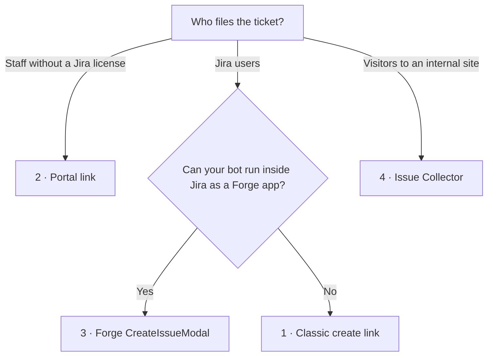

# נספח · דרכים נוספות לפתוח את Jira עם שדות ממולאים מראש

[English](appendix-create-entry-points.en.md) · [1 גישה](01-read-only-access.he.md) · [2 קריאה מ־Jira](02-reading-jira.he.md) · [3 קישור היצירה](03-create-link.he.md) · [4 שילוב בצ׳אטבוט](04-chatbot-integration.he.md) · **נספח**

מדריך 3 משתמש בקישור היצירה הקלאסי. ל־Jira יש נקודות כניסה נוספות שפותחות טופס יצירה עם ערכים ממולאים. כל אחת מתאימה לקהל אחר, ואף אחת מהן לא יוצרת שום דבר עד שהאדם שולח את הטופס.

## באיזו מהן להשתמש

| נקודת כניסה | מתאימה במיוחד ל | מה האדם צריך | מה אפשר למלא מראש | יציבות |
| --- | --- | --- | --- | --- |
| 1. קישור יצירה קלאסי | משתמשי Jira שפותחים טיקטים בפרויקטי תוכנה או בפרויקטים עסקיים | רישיון Jira | כל שדה שמופיע במסך היצירה | מתועד ב־Data Center. ב־Cloud הוא עובד, אבל נחשב מורשת (legacy). |
| 2. קישור לפורטל ה־service desk | עובדים שפותחים בקשות ל־IT, ל־HR או לאחזקה | גישה לפורטל בלבד (בלי רישיון) | תקציר, תיאור, שדות של סוג הבקשה | נתמך, עם נקודות חיכוך |
| 3. ‏`CreateIssueModal` של Forge | צ׳אטבוט או דף שרצים **בתוך** Jira כאפליקציית Forge | רישיון Jira | רוב שדות המערכת והשדות המותאמים (custom fields) | נתמך רשמית, חלון יצירה מודרני |
| 4. ‏Issue Collector | כפתור משוב באתר פנימי | כלום, או חשבון Jira, לפי ההגדרות | שדות טקסט, שדות בחירה ושדות מותאמים | טכנולוגיה ישנה |
| 5. ‏Jira Forms | צוותים עסקיים | רישיון Jira | אין מילוי מראש מובנה דרך URL | דורש אפליקציה מ־Marketplace |



---

## 1. קישור יצירה קלאסי

מוסבר במלואו ב[מדריך 3](03-create-link.he.md):

```
https://your-company.atlassian.net/secure/CreateIssueDetails!init.jspa?pid=10001&issuetype=10011&summary=Booking%20page%20crashes&priority=2
```

**הסיכון ב־Cloud.** ב־2022 הודיעה Atlassian שתוציא משימוש את מסך היצירה בעמוד מלא ב־Cloud, ותפנה כתובות `CreateIssue.jspa` לחוויית היצירה החדשה. נכון לדיווח באג ממאי 2026, ‏`CreateIssueDetails!init.jspa` עדיין פותח את המסך הישן עם הפרמטרים שלו. Atlassian לא אמרה אם המילוי המראש ישרוד את ההפניה. ב־Data Center הקישור הזה מתועד ויציב.

**בדקו מדי פעם:** פתחו קישור מלא מהצ׳אטבוט שלכם כשאתם מחוברים. אם נפתח חלון יצירה שנראה אחרת והשדות בו ריקים, המילוי המראש הפסיק לעבוד, והגיע הזמן לעבור לאפשרות 2 או 3.

---

## 2. קישור לפורטל ה־service desk

הפורטלים של Jira Service Management מקבלים ערכי שדות מתוך ה־URL. זו הבחירה המקובלת בארגונים: כל מי שיש לו גישה לפורטל יכול לפתוח בקשה בלי רישיון Jira, והבקשה מגיעה עם סוג הבקשה (request type) הנכון.

```
https://your-company.atlassian.net/servicedesk/customer/portal/{portalId}/create/{requestTypeId}?summary=…&description=…&customfield_NNNNN=…
```

### דוגמה

בקשה ל־IT בנוגע למחשב נייד. מזהה הפורטל הוא 3, סוג הבקשה הוא 27 («Hardware problem»), והשדה «Urgency» שלו הוא `customfield_10050`:

```
https://your-company.atlassian.net/servicedesk/customer/portal/3/create/27
  ?summary=Laptop%20won%27t%20boot%20after%20update
  &description=Since%20this%20morning%27s%20update%20the%20laptop%20shows%20a%20black%20screen.
  &customfield_10050=10021
```

‏`10021` הוא **מזהה האפשרות** (option ID) של «High». רשימות נפתחות, תיבות סימון וכפתורי בחירה (radio buttons) מקבלים מזהי אפשרויות, לא תוויות.

### איתור המזהים (REST לקריאה בלבד)

אותה גישה של קריאה בלבד כמו ב[מדריך 2](02-reading-jira.he.md). הטוקן צריך גם הרשאת קריאה ל־JSM. ב־Cloud הוסיפו את ההרשאה (scope) `read:servicedesk-request`.

```bash
# Service desks (projects with a portal)
curl -u "$EMAIL:$TOKEN" "$JIRA/rest/servicedeskapi/servicedesk"
# {"values":[{"id":"3","projectKey":"IT","projectName":"IT Support"}]}

# Request types; each carries the portalId used in the URL
curl -u "$EMAIL:$TOKEN" "$JIRA/rest/servicedeskapi/servicedesk/3/requesttype"
# {"values":[{"id":"27","name":"Hardware problem","portalId":"3","issueTypeId":"10004"}]}

# Fields on that request form, with option IDs
curl -u "$EMAIL:$TOKEN" "$JIRA/rest/servicedeskapi/servicedesk/3/requesttype/27/field"
# {"requestTypeFields":[
#   {"fieldId":"summary","name":"What's wrong?","required":true,"validValues":[]},
#   {"fieldId":"customfield_10050","name":"Urgency","required":false,
#    "validValues":[{"value":"10020","label":"Low"},{"value":"10021","label":"High"}]}]}
```

רק השדות שמוחזרים מהקריאה ל־`field` מופיעים בטופס הפורטל. כל דבר אחר ב־URL לא נלקח בחשבון. ב־Data Center הנתיבים זהים.

### בונה קישור

```ts
export function buildPortalLink(
  site: string, portalId: string, requestTypeId: string,
  fields: Record<string, string | undefined>,          // fieldId → value (option ID for selects)
) {
  const params = new URLSearchParams();
  for (const [fieldId, value] of Object.entries(fields)) if (value) params.set(fieldId, value);
  const query = params.toString().replace(/\+/g, "%20");
  return `${site}/servicedesk/customer/portal/${portalId}/create/${requestTypeId}${query ? `?${query}` : ""}`;
}

buildPortalLink("https://your-company.atlassian.net", "3", "27", {
  summary: "Laptop won't boot after update",
  customfield_10050: "10021",
});
// https://your-company.atlassian.net/servicedesk/customer/portal/3/create/27?summary=Laptop%20won%27t%20boot%20after%20update&customfield_10050=10021
```

### נקודות חיכוך

- אם האדם מחליף סוג בקשה או עובר לדף אחר בתוך הפורטל, הערכים מה־URL הולכים לאיבוד.
- שדות שמגיעים מ**טופס** (Form) מצורף, בניגוד לשדות של סוג הבקשה, לרוב לא מתמלאים מראש.
- חלק מהרשימות הנפתחות שמולאו מראש עדיין נכשלות באימות, והאדם צריך לבחור את הערך שוב.
- יש דיווחים על מילוי מראש שהפסיק לעבוד אחרי עדכונים בפורטל. בדקו את הקישור שוב מדי פעם.

---

## 3. ‏`CreateIssueModal` של Forge

אם הבוט או הדף שלכם יכולים לרוץ **בתוך Jira** כאפליקציית Forge (למשל דף גלובלי, פאנל בפריט עבודה, או ממשק צ׳אט שאתם מארחים ב־Jira), ה־`CreateIssueModal` של Atlassian פותח את חלון היצירה **המודרני** עם ערכים ממולאים מראש. זה המסלול שנתמך רשמית, והוא לא תלוי בכתובות URL מורשת (legacy).

```ts
import { CreateIssueModal } from "@forge/jira-bridge";

const adf = (text: string) => ({
  type: "doc", version: 1,
  content: text.split("\n").map(line => ({ type: "paragraph", content: line ? [{ type: "text", text: line }] : [] })),
});

new CreateIssueModal({
  context: {
    projectId: "10001",
    issueTypeId: "10011",                       // Bug
    summary: "Booking page crashes on Safari when selecting a date",
    description: adf("Steps to reproduce:\n1. Open the booking page in Safari\n2. Pick a date"),
    reporter: "712020…",                        // account ID
    priority: "2",                              // priority ID
    labels: ["safari"],
    fixVersions: ["10000"],
    customfield_10050: "EU",                    // custom fields by ID
  },
  onClose: ({ payload }) => {
    // The IDs of tickets the person actually created. The bot can now confirm "Created DESK-42".
    const created = payload.map(item => item.issueId);
  },
}).open();
```

מה מייחד אותו:

- **הוא יודע מה יצא בסוף.** ‏`onClose` מחזיר את המזהים של הטיקטים שנוצרו. עם קישור, הבוט אף פעם לא יודע אם האדם לחץ על Create.
- **התיאור הוא אובייקט מסמך** בפורמט Atlassian Document Format (ADF) ולא טקסט פשוט, ולכן הדוגמה משתמשת ב־`adf()`.
- **נקודות תורפה:** מפתחים מדווחים ש־`parentId` (Epic) ו־`components` לפעמים לא מתמלאים, ושתת־משימות (subtasks) לא נתמכות. בדקו את זה במופע שלכם.
- **יש בו תמיכה גם ב־`requestType`** לפרויקטים של Jira Service Management.
- המחיר: אפליקציית Forge שמותקנת במופע ה־Jira שלכם, ולא רק צ׳אטבוט שרץ מחוץ לו.

---

## 4. ‏Issue Collector

סקריפט קטן שמוטמע בדף אינטרנט פנימי ומציג כפתור «Feedback» וטופס יצירה קצר. ערכי ברירת המחדל נקבעים ב־`fieldValues`, לפי שמות השדות ממסך היצירה של Jira:

```js
window.ATL_JQ_PAGE_PROPS = $.extend(window.ATL_JQ_PAGE_PROPS, {
  fieldValues: {
    summary: "Feedback on the new booking page",
    description: "Page: /booking\nBrowser: Safari 18",
    priority: "2",
    customfield_10110: ["10039", "10037"],   // multi-select: always an array of option IDs
    customfield_11111: "San Francisco",       // text custom field
  },
});
```

אפשר לקבוע כך גם שדות שלא מוצגים בטופס של ה־collector, והטיקט שנוצר יקבל אותם. זמין ב־Data Center ובפרויקטים מנוהלי־חברה (company-managed) ב־Cloud. זו טכנולוגיה ישנה. לעבודה חדשה העדיפו את אפשרות 2 או 3.

---

## 5. ‏Jira Forms

ב־Jira Forms המובנה **אין מילוי מראש דרך URL**, ובקשת הפיצ׳ר עדיין פתוחה. אפליקציות מ־Marketplace (למשל Smart Forms, או אפליקציות שמייצרות קישורי בקשה ממולאים מראש) מוסיפות את היכולת הזו. השתמשו בהן רק אם הארגון שלכם כבר מאשר את האפליקציות האלה.

---

## לא נכלל כאן: יצירה בלי טופס

יש צוותים שמוותרים על הטופס לגמרי: הבוט קורא ל־REST API עם חשבון שירות, או שולח בקשה ל־**incoming webhook** של Jira Automation, שהכלל (rule) שלו יוצר את הטיקט. זה מסלול כתיבה בלי שלב של בדיקה אנושית. זה ההפך מהתכנון של קריאה בלבד שבמדריכים האלה, והוא דורש סקירת אבטחה משלו.

## מקורות

- [JRACLOUD-98249: CreateIssueDetails!init.jspa is not redirected to the new create screen](https://jira.atlassian.com/browse/JRACLOUD-98249)
- [הוצאת מסך היצירה בעמוד מלא משימוש ב־Jira Cloud ‏(2022)](https://community.atlassian.com/forums/Jira-articles/Retiring-full-page-issue-create-in-Jira-Cloud/ba-p/2206600)
- [תיעוד העזר של CreateIssueModal ב־Forge](https://developer.atlassian.com/platform/forge/apis-reference/jira-api-bridge/createIssueModal) · [הבעיה עם parentId](https://community.developer.atlassian.com/t/unable-to-se-parentid-on-createissuemodal/75103)
- [ה־REST API של סוגי בקשות ב־JSM](https://developer.atlassian.com/cloud/jira/service-desk/rest/api-group-requesttype/) · [מילוי שדות מראש מתוך ה־URL](https://community.atlassian.com/forums/Jira-Service-Management-articles/Pre-populate-Fields-from-URL/bc-p/2514110) · [JSDCLOUD-9270](https://jira.atlassian.com/browse/JSDCLOUD-9270) · [JSDCLOUD-18571](https://jira.atlassian.com/browse/JSDCLOUD-18571)
- [שימוש מתקדם ב־Issue Collector של Jira](https://confluence.atlassian.com/adminjiraserver/advanced-use-of-the-jira-issue-collector-938847349.html)
- [מילוי מראש של Jira Forms דרך URL (שאלה בקהילה)](https://community.atlassian.com/forums/Jira-questions/Is-it-possible-to-pre-populate-quot-Project-Form-quot-values/qaq-p/2447230)
